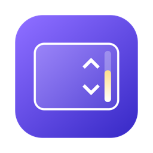

<p align="center">
  
</p>

<h1 align="center">SlideEdge</h1>

<p align="center">I bordi del trackpad del Mac diventano controlli.</p>

<p align="center"><a href="README.md">English</a></p>

---

SlideEdge è una piccola app per la barra dei menu. Fai scorrere un dito lungo un bordo del trackpad
per cambiare luminosità o volume, fai uno swipe sul bordo inferiore per cambiare brano, tocca due
volte un angolo per il muto. Riconosce solo i gesti che partono da un bordo: puntatore, scroll e
gesti di sistema continuano a funzionare.

| Bordo | Gesto | Azione |
|---|---|---|
| Sinistro | slide su / giù | Luminosità del display |
| Destro | slide su / giù | Volume |
| Superiore | slide sinistra / destra | Retroilluminazione tastiera |
| Inferiore | swipe sinistra / destra · doppio tap | Brano precedente / successivo · play / pausa |
| Angolo in alto a destra | doppio tap | Muto |
| Angolo in alto a sinistra | doppio tap | Mission Control, Mostra scrivania, Launchpad, Istantanea schermo o Blocca schermo |

Puoi scambiare i lati, limitare ogni lato a una parte del bordo, richiedere Fn o ⌥, oppure passare
ai quarti di scatto (tieni ⇧⌥ durante lo slide).

## Funzioni

- **Bordi intelligenti**: uno slide vale solo se parte dentro il bordo, con un dito, e si muove lungo
  il bordo. I gesti a due dita e gli swipe dal bordo (Centro Notifiche) restano al sistema.
- **Palm rejection**: nessuno slide per mezzo secondo dopo un tasto. Viene registrato solo l'istante
  della pressione, mai quale tasto.
- **Volume** del dispositivo di uscita attuale (CoreAudio), con i tasti volume come riserva per i
  dispositivi senza volume software.
- **Luminosità** del display integrato e dei monitor Apple, e degli altri monitor esterni tramite
  DDC/CI su Apple Silicon.
- **Retroilluminazione tastiera**, **tasti multimediali**, **muto**.
- Feedback aptico, indicatore di livello a schermo (anche sopra le app a schermo intero), cursore
  bloccato durante lo slide.
- Più trackpad: integrato, Magic Trackpad e, se vuoi, Magic Mouse.
- CPU a zero a riposo: non gira nulla finché un dito non tocca il trackpad.

## Requisiti

macOS 13 Ventura o successivo, Apple Silicon o Intel. Il DDC/CI per i monitor di terze parti
funziona solo su Apple Silicon.

## Installazione

1. Scarica l'ultimo `SlideEdge-x.y.dmg` dalle [Release](../../releases) e trascina SlideEdge in Applicazioni.
2. Le release non sono notarizzate (servirebbe un account Apple Developer a pagamento), quindi macOS
   blocca il primo avvio. Apri **Impostazioni di Sistema → Privacy e sicurezza** e clicca
   **Apri comunque**, oppure da Terminale:
   ```sh
   xattr -dr com.apple.quarantine /Applications/SlideEdge.app
   ```
3. Concedi i due permessi che SlideEdge chiede:
   - **Accessibilità**: per inviare i tasti multimediali e di volume e bloccare il cursore.
   - **Monitoraggio input**: per la palm rejection.

Oppure compilala da te (sotto).

## Compilare

Serve Xcode 16 o successivo.

```sh
git clone https://github.com/SamuelSystems/SlideEdge.git
cd SlideEdge
cp Config/Local.xcconfig.example Config/Local.xcconfig   # poi inserisci il tuo Team ID
open SlideEdge.xcodeproj                                  # ⌘R
```

Senza `Config/Local.xcconfig` l'app viene firmata ad-hoc: funziona, ma macOS dimentica i permessi di
Accessibilità e Monitoraggio input a ogni build. Per avere un Team ID basta un account Apple gratuito.

Test (il motore dei gesti è coperto da test con sequenze di tocchi simulate):

```sh
swift test --package-path Packages/SlideEdgeKit
```

Build di release (app universale, `.zip` e `.dmg` in `dist/`):

```sh
./scripts/release.sh --version 1.0
```

Con un certificato Developer ID nel portachiavi lo script firma con quello, e con
`NOTARY_PROFILE=<profilo>` notarizza anche (vedi i commenti nello script).

## Come è fatta

| Percorso | Contenuto |
|---|---|
| `App/` | Target dell'app: coordinator, router delle azioni, pannello della barra dei menu, onboarding, finestra di debug dei tocchi |
| `Packages/SlideEdgeKit/` | Swift package, un modulo per responsabilità |
| `design/` | Sorgenti dell'icona |
| `scripts/release.sh` | Build di release |

Moduli: `TouchInput` (tocchi raw), `GestureEngine` (logica pura dei gesti), `SystemControls`
(volume, luminosità, retroilluminazione, tasti multimediali, DDC/CI), `HUD`, `Haptics`,
`CursorControl`, `KeyActivity`, `CornerActions`, `AppSettings`, `Permissions`.

Le build di debug accettano `-previewPanel main|settings` (mostra il pannello in una finestra) e
`-testHUD` (mostra ripetutamente l'indicatore di livello).

### API private

macOS non offre API pubbliche per i tocchi raw del trackpad, la luminosità del display o la
retroilluminazione della tastiera, quindi SlideEdge usa framework privati. Per questo non è in
sandbox e non può stare sul Mac App Store. Ogni simbolo è risolto a runtime e verificato prima
dell'uso: se un aggiornamento di macOS ne toglie uno, la funzione relativa si disattiva senza crash.

| API | Uso |
|---|---|
| MultitouchSupport | lettura dei tocchi |
| DisplayServices | luminosità (display integrato e monitor Apple) |
| IOKit `IOAVServiceReadI2C` / `WriteI2C` | luminosità via DDC/CI (monitor esterni, Apple Silicon) |
| CoreBrightness `KeyboardBrightnessClient` | retroilluminazione tastiera |
| `CGSSetConnectionProperty("SetsCursorInBackground")` | nascondere il cursore da un'app in background |
| `CoreDockSendNotification`, `SACLockScreenImmediate` | Mostra scrivania, Blocca schermo |

## Contribuire

Issue e pull request sono benvenute. Esegui i test prima di aprire una pull request e aggiungi test
in `GestureEngineTests` per le modifiche al riconoscimento dei gesti.

## Ringraziamenti

Ispirata a [EdgeBar](https://edgebar.xyz). SlideEdge è un progetto indipendente, non affiliato.

## Licenza

[GPL-3.0](LICENSE). Puoi usare, modificare e ridistribuire SlideEdge; le versioni ridistribuite,
modificate o no, devono essere rilasciate con la stessa licenza e con il loro codice sorgente.
