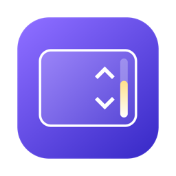
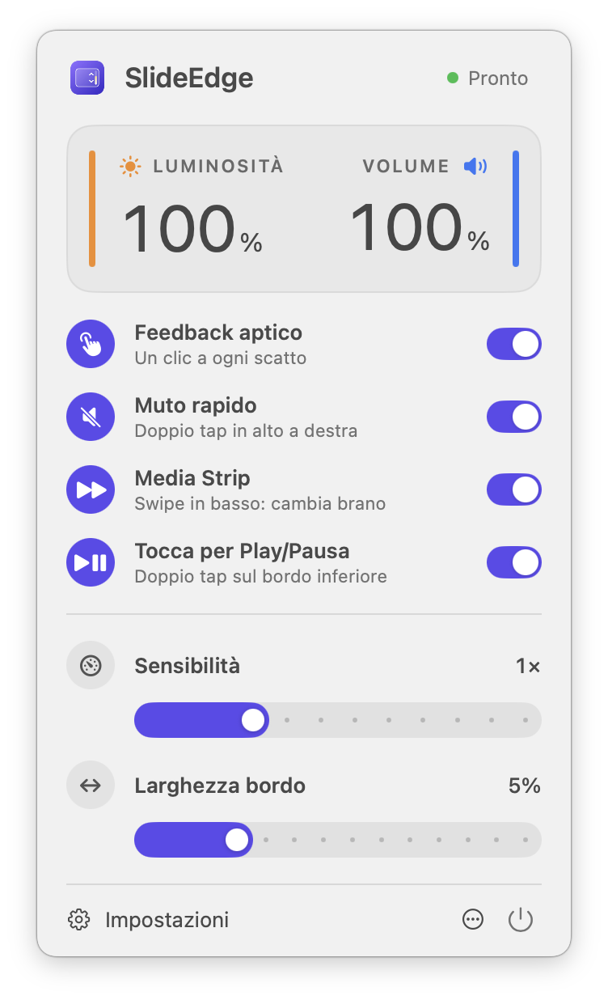
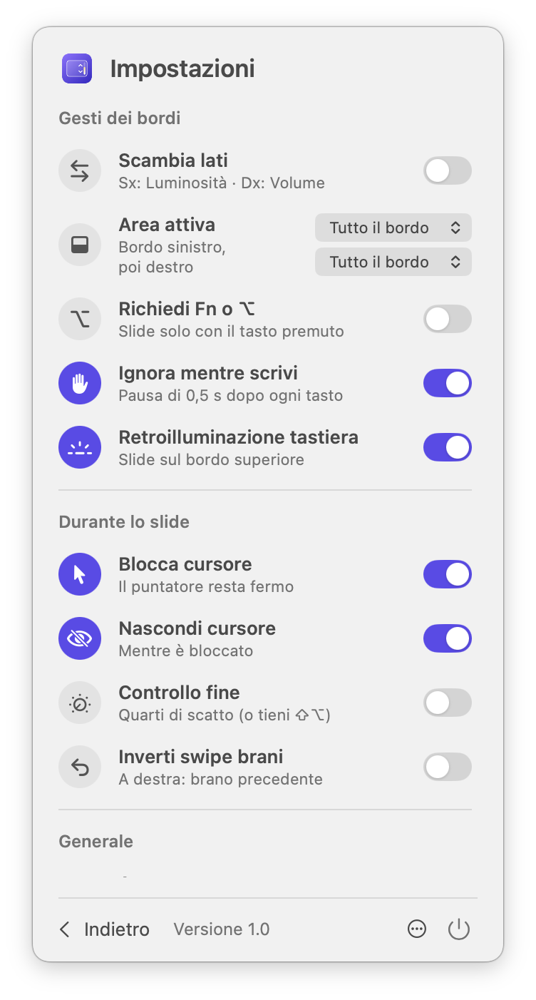
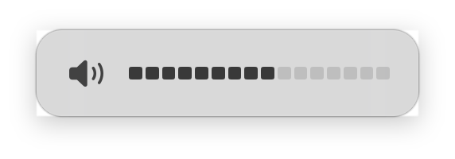

<p align="center">
  
</p>

<h1 align="center">SlideEdge</h1>

<p align="center">Turn the edges of your Mac trackpad into controls.</p>

<p align="center"><a href="README.it.md">Italiano</a></p>

<p align="center">
  
  
</p>
<p align="center">
  
</p>

---

SlideEdge is a small menu bar app. Slide a finger along an edge of the trackpad to change the
brightness or the volume, swipe the bottom edge to skip songs, double-tap a corner to mute.
It recognizes only gestures that start on an edge, so normal pointing, scrolling and system
gestures keep working.

| Edge | Gesture | Action |
|---|---|---|
| Left | slide up / down | Display brightness |
| Right | slide up / down | Volume |
| Top | slide left / right | Keyboard backlight |
| Bottom | swipe left / right · double tap | Previous / next track · play / pause |
| Top-right corner | double tap | Mute |
| Top-left corner | double tap | Mission Control, Show Desktop, Launchpad, Screenshot or Lock Screen |

Swap the sides, limit each side to part of the edge, require Fn or ⌥, or switch to quarter steps
(hold ⇧⌥ while sliding).

## Features

- **Smart edges** — a slide counts only if it starts inside the edge, uses one finger and moves along
  the edge. Two-finger gestures and swipes from the edge (Notification Center) are left alone.
- **Palm rejection** — no new slides for half a second after a key press. Only the time of the key
  press is recorded, never which key.
- **Volume** on the current output device (CoreAudio), with a fallback to the volume keys for
  devices without a software volume.
- **Brightness** of the built-in display and Apple displays, and of other external monitors through
  DDC/CI on Apple Silicon.
- **Keyboard backlight**, **media keys**, **mute**.
- Haptic feedback, an on-screen level indicator (also over full-screen apps), pointer freeze while
  sliding.
- Multiple trackpads: built-in, Magic Trackpad, optionally Magic Mouse.
- No CPU use at rest: nothing runs until a finger touches the trackpad.

## Requirements

macOS 13 Ventura or later, Apple Silicon or Intel. DDC/CI for third-party monitors works on Apple
Silicon only.

The interface is in Italian for now; translations are welcome (see Contributing).

## Install

1. Download the latest `SlideEdge-x.y.dmg` from [Releases](../../releases) and drag SlideEdge to Applications.
2. The release builds are not notarized (this needs a paid Apple Developer account), so macOS blocks
   the first launch. Open **System Settings → Privacy & Security** and click **Open Anyway**, or run:
   ```sh
   xattr -dr com.apple.quarantine /Applications/SlideEdge.app
   ```
3. Grant the two permissions SlideEdge asks for:
   - **Accessibility**: to send the media and volume keys and to freeze the pointer.
   - **Input Monitoring**: for palm rejection.

Or build it yourself (below).

## Build

Requires Xcode 16 or later.

```sh
git clone https://github.com/SamuelSystems/SlideEdge.git
cd SlideEdge
cp Config/Local.xcconfig.example Config/Local.xcconfig   # then set your Team ID in it
open SlideEdge.xcodeproj                                  # ⌘R
```

Without `Config/Local.xcconfig` the app is signed ad hoc. That works, but macOS forgets the
Accessibility and Input Monitoring permissions after every build. A free Apple account is enough
for a team ID.

Tests (the gesture engine is fully unit-tested with simulated touch sequences):

```sh
swift test --package-path Packages/SlideEdgeKit
```

Release build (universal app, `.zip` and `.dmg` in `dist/`):

```sh
./scripts/release.sh --version 1.0
```

With a Developer ID certificate in the keychain the script signs with it, and with
`NOTARY_PROFILE=<profile>` it also notarizes (see the comments in the script).

## How it works

| Path | Contents |
|---|---|
| `App/` | App target: coordinator, action router, menu bar panel, onboarding, touch debug window |
| `Packages/SlideEdgeKit/` | Swift package, one module per concern |
| `design/` | Icon sources |
| `scripts/release.sh` | Release build |

Modules: `TouchInput` (raw touches), `GestureEngine` (pure gesture logic), `SystemControls` (volume,
brightness, keyboard backlight, media keys, DDC/CI), `HUD`, `Haptics`, `CursorControl`,
`KeyActivity`, `CornerActions`, `AppSettings`, `Permissions`.

Debug builds accept `-previewPanel main|settings` (shows the menu bar panel in a window) and
`-testHUD` (shows the level indicator repeatedly).

### Private APIs

macOS has no public API for raw trackpad touches, display brightness or the keyboard backlight, so
SlideEdge uses private frameworks. That is why it is not sandboxed and cannot be on the Mac App
Store. Every symbol is resolved at runtime and checked before use: if a macOS update removes one,
the related feature turns off instead of crashing.

| API | Used for |
|---|---|
| MultitouchSupport | reading touches |
| DisplayServices | brightness (built-in and Apple displays) |
| IOKit `IOAVServiceReadI2C` / `WriteI2C` | brightness over DDC/CI (external monitors, Apple Silicon) |
| CoreBrightness `KeyboardBrightnessClient` | keyboard backlight |
| `CGSSetConnectionProperty("SetsCursorInBackground")` | hiding the pointer from a background app |
| `CoreDockSendNotification`, `SACLockScreenImmediate` | Show Desktop, Lock Screen |

## Contributing

Issues and pull requests are welcome. Please run the tests before opening a pull request, and add
tests to `GestureEngineTests` for changes to gesture recognition.

## Acknowledgements

Inspired by [EdgeBar](https://edgebar.xyz). SlideEdge is an independent project and is not
affiliated with it.

## License

[GPL-3.0](LICENSE). You may use, modify and redistribute SlideEdge; redistributed versions,
modified or not, must be released under the same license with their source code.
